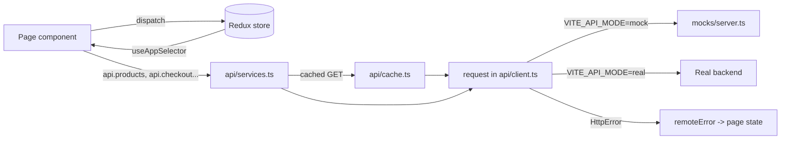

# Architecture

The Bug Bazaar is a React + TypeScript single-page app. It runs on Vite, with
React Router for pages, Redux Toolkit for cart and session state, and a mock API
that stands in for a real backend.

## Folder structure

```
index.html                 Entry HTML, loads src/main.tsx
src/
  main.tsx                 Mounts the app: StrictMode, Redux Provider, BrowserRouter
  App.tsx                  Routes, header, route guard (Protected), footer,
                           and the 15-second cart stock sync
  api/
    client.ts              request() (all HTTP), HttpError, remoteError() (error mapping)
    services.ts            One function per endpoint (api.products, api.checkout, ...)
    cache.ts               60-second in-memory cache for GET responses
  components/Ui.tsx        ProductCard, StateView, BackToTop, ErrorBoundary
  hooks/index.ts           useAppDispatch/useAppSelector, useDebounced, useBackToTop
  pages/                   One file per route: Catalog, ProductDetails, Cart,
                           Checkout, OrderConfirmation, Auth (Login), Account
  store/index.ts           Redux store: cart and session slices, storage sync
  mocks/
    seed.ts                5,000 products generated from the category names
    server.ts              The mock API: routes, validation, stock, orders
  types/                   Shared types (api.ts is the contract)
  utils/catalog.ts         Pure helpers: money(), filterProducts(), cartTotal()
docs/                      Written documentation
```

## Layers

Data moves in one direction: page → hook or service → `request()` → API.



- **Pages** own what they render. They never call `fetch` directly.
- **services.ts** has one function per endpoint and adds caching where it's safe.
- **client.ts** adds the auth header, parses errors, and sends 401s to the sign-out
  handler.
- **mocks/server.ts** implements the contract in `docs/api-contract.md`.

## Where each kind of state lives

| Kind | Where | Example | Lifetime |
| --- | --- | --- | --- |
| Server | The API (mock: `localStorage` `bazaar-stock-v1` and `bazaar-orders-v1`) | Products, stock, orders | Owned by the server |
| Client, global | Redux (`cart`, `session`) | Cart lines, signed-in user | Saved to `localStorage` (cart) and `sessionStorage` (session) |
| Client, cache | `api/cache.ts` | Product lists, product details | 60 seconds, memory only |
| URL | Query string | Search, category, sort, page, in-stock | Lives in the address bar |
| Local component | `useState`/`useRef` | Form inputs, pending flags, request results | Until the component unmounts |
| Browser storage, not app state | `sessionStorage` | Checkout key | Until the order succeeds |

## Data flow example: searching the catalog

1. The user types in the search box. `input` changes, and `useDebounced` waits 300 ms.
2. Once the input settles, the page writes the search to the URL.
3. The URL change makes `filters` change. The request effect calls `api.products`.
4. `api.products` returns cached data if it is less than 60 seconds old.
   Otherwise it calls `request()`.
5. The response is stored with the request key it belongs to. Only the newest
   request's result is shown.

## Routes

| Path | Page | Guard |
| --- | --- | --- |
| `/` | Catalog | none |
| `/products/:id` | ProductDetails | none |
| `/cart` | Cart | none |
| `/login` | Login | none |
| `/account` | Account | signed in |
| `/checkout` | Checkout | signed in |
| `/orders/:id` | OrderConfirmation | signed in |
| anything else | Not found | none |

## Things to know

- `App.tsx` reads `localStorage` directly for the stock sync instead of going
  through the store. This is a shortcut that should be cleaned up.
- `src/services/productService.ts` isn't used and should be deleted.
- The legacy Week 1 files (`App.jsx`, `main.jsx`, `mockApi.js`, `components/Bug*`,
  `pages/BugDetails.jsx`, `pages/NotFound.jsx`) are still in the repo but are not
  imported. `mockApi.js` is in the README's "don't change" list, so it was left as is.
