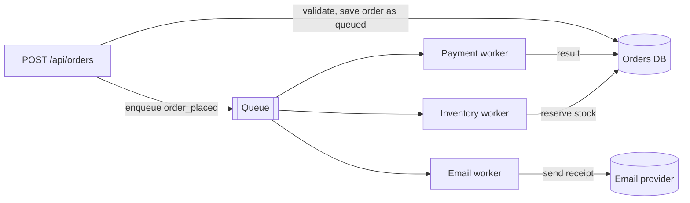

# Order flow

## What the code does today

1. The user signs in, so the request carries a token.
2. Checkout sends the cart lines and an `idempotencyKey` to `POST /api/orders`.
3. The server checks that every line is in stock. If one isn't, it returns 409 and
   changes nothing.
4. If every line is in stock, the server takes the stock and saves the order. It
   returns 201 with `status: 'queued'`.
5. The app clears the cart, clears the cached products, and opens
   `/orders/:id`.

Everything happens in one request. The mock doesn't call a payment provider, send
email, or use a queue. The `queued` status is the only sign of asynchronous
processing, and nothing processes it.

## Why the idempotency key prevents double charges

A retry can happen when the user double-clicks, the network drops, or the page
reloads. Each checkout attempt has one key, stored in `sessionStorage`
(`src/pages/Checkout.tsx`). The server stores the completed order under that key.
A retry with the same key gets back the same order, and nothing is charged or
decremented a second time. The key is cleared only after the app sees success.

The real protection is on the server. A key that the client generates in
memory would be lost on reload, which is why the key is stored.

## Target design: a queue for payment, inventory, and email

In a real system, the order endpoint should only accept the order and put a job on
a queue. Workers handle the rest.

- **Why a queue helps:** payment and email can be slow or fail. The API responds
  quickly, and each worker can retry on its own without holding up checkout.
- **If email is down:** the order is already saved and paid. The email worker
  keeps the message in the queue and retries with backoff. After a set number of
  tries it goes to a dead-letter queue for a person to check. The customer still
  has the order.
- **How the idempotency key prevents double charges:** the payment worker sends
  the key to the payment provider. The provider returns the first result for a
  repeated key, so a retried job can't charge twice. The same key is also stored
  on the order, so a repeated checkout request returns the existing order, as the
  mock does.

## Status of this project

The queue is a design only. The mock keeps the same contract (`queued` status,
idempotent key), so the design can be added later without changing the app.
